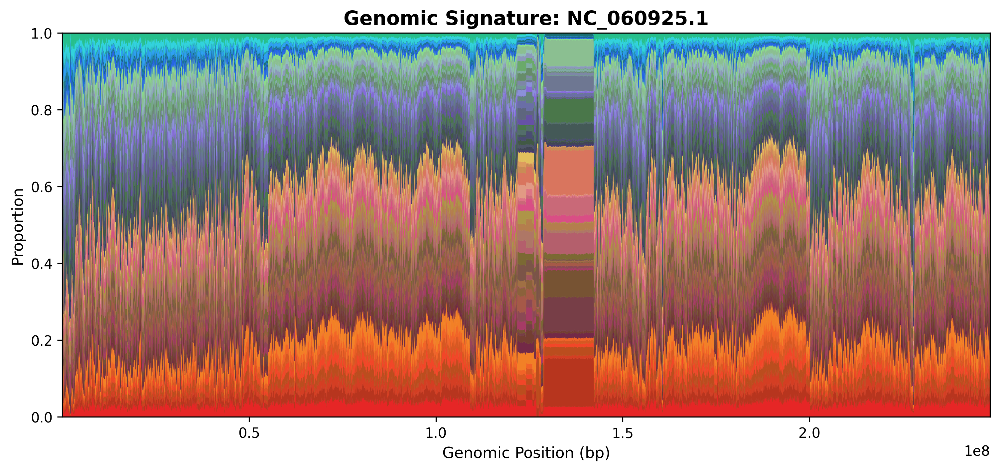
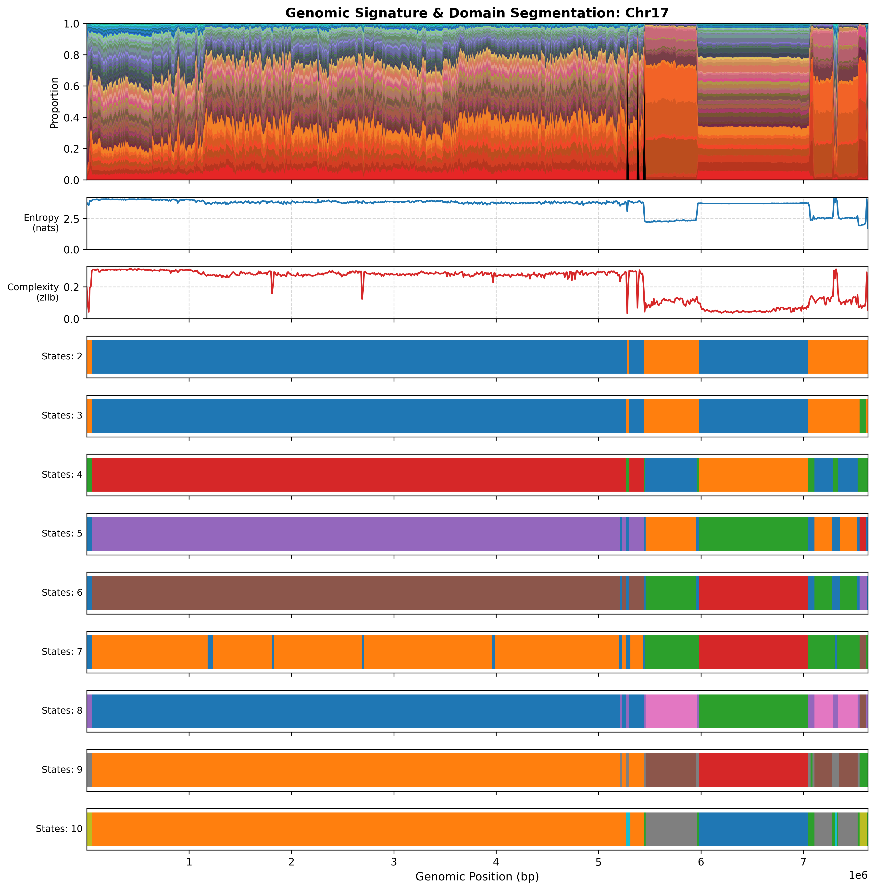
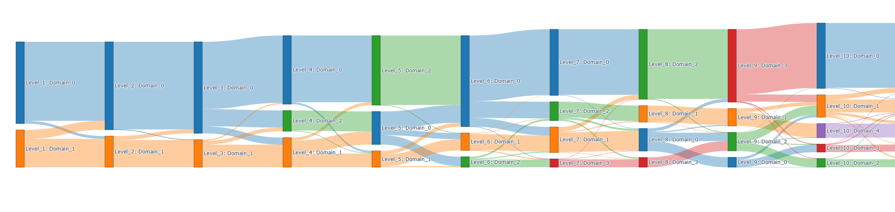

# Birds Eye Genome (BEG)
### *"Genomic sequence signature at a distance."*
___
## Author
* **Andrew Ontano**, Center for Applied Genetic Techniques, University of Georgia 
---
## About BEG
**Birds Eye Genome** (**BEG**) is the successor to the [Spectra](https://github.com/Andrew-Ontano/Spectra) toolkit for visualizing genome-scale sequences and inferring regional shifts in coherent genome patterns. 
* User supplies a FASTA file of one or more genomic sequences
* **BEG** outputs "Horizon Plots" as both static figures for publication and interactive Web application modules for exploring genome-wide k-mer signatures and segmenting regional domain identities.
* Designed for super-short k-mers (typically k=2 to k=6) but the file format and visualization as described below can support a shortlist of user-supplied, longer k-mers that can be counted via a prior word search. 
* This toolkit does not replace assembly quality assessments such as repeat analyses, read depth coverage, nor read remapping, but serves to facilitate the sequencing-to-scaffolding process with visual indicators. 

## Horizon Plots
DNA is not a monolith. Within genic regions, the ratio of GC-richness can fluctuate dramatically. Likewise, the richness of a more complex alphabet of k-mers can fluctuate but be masked by a more consistent GC-richness. These plots serve to gradually increase the alphabet of the genome while maintaining readability through an AT (orange-red) to GC (blue-green) color scheme. The goal of this tool is to assist with showcasing how complex genomes are and to contrast large stretches of tandemly repetitive DNA from one another. Large tandem repeats correspond to regions where colors flatten out. Simpler repeats (e.g.: stretches of ATAT) have fewer, wider bands whereas more complex repeats (e.g.: centromeric satellites, rDNA arrays) have more bands that are typically thinner.

### Human chromosome 1 ([Paper](https://doi.org/10.1126/science.abj6987), [Genbank](https://www.ncbi.nlm.nih.gov/datasets/genome/GCF_009914755.1/)), 50 kilo-basepair windows, k=3 ([Canonical plot](includes/images/Homo_sapiens_50kbp_canonical_NC_060925.1.png)) [Color key](includes/images/k3_key.png)


---

## Installation

### Prerequisites & Conda Environment Setup

BEG requires Python 3.12 or higher.Conda or Mamba are recommended to create an isolated environment with all necessary scientific dependencies:

```bash
# Create a new Conda environment with Python 3.12
conda create -n BEG python=3.12 -y

# Activate the environment
conda activate BEG

# Clone repository and install BEG in editable mode
git clone https://github.com/Andrew-Ontano/BirdsEyeGenome.git
cd BirdsEyeGenome
pip install -e .
```

Dependencies installed via `pyproject.toml` include `biopython`, `pandas`, `numpy`, `matplotlib`, `plotly`, `dash`, `scikit-learn`, `scipy`, and `hmmlearn`.

---

## Workflow Synopsis

BEG provides a modular CLI interface via `beg.py` and dedicated utilities in `src/utils/`:

1. **`beg count`**: Sliding window k-mer frequency counting across FASTA sequence contigs. Computes k-mer counts alongside zlib compression complexity per window and outputs tab-separated `.beg` text files or binary SQLite `.db` databases.
2. **`beg domains`**: Dimensionality reduction (PCA) and sequence segmentation using Hidden Markov Models (GaussianHMM). Uncovers hidden domain states across expected cluster counts ($N$-states) and computes Shannon entropy and zlib complexity per window.
3. **`beg plot`**: Generates high-resolution stacked sequence signature figures (PNG, PDF, SVG) displaying k-mer composition patterns.
4. **`beg server`**: Launches an interactive Dash web application (`http://127.0.0.1:8050`) for closer looks at genome signature inspection.
5. **`src/utils/domain_visualize.py`**: Visualizes aligned stacked k-mer signatures, Shannon entropy line graphs, zlib complexity line graphs, and horizontal domain state prediction blocks.
6. **`src/utils/hierarchical_composition.py`**: Integrates multi-window domain datasets across different window sizes and state counts into a consolidated hierarchical genome composition table.

---

## Example Pipeline Block

A complete end-to-end multi-window analytical pipeline for a genome FASTA file (`genome.fasta`):

```bash
# 1. Count k-mers across small (10kb) and large (50kb) window sizes with no overlap
# For best visualization, I recommend window sizes around 1/1,000 the typical chromosome size
beg count -i genome.fasta -w 10000 -s 10000 -o genome_10k.beg

# 2. Perform regional domain segmentation across state ranges (e.g. 2 to 8 states)
beg domains -i genome_10k.beg -n "2:8" -o genome_10k_domains.beg

# 3a. Generate static signature plots
beg plot -i genome_10k.beg -o genome_10k_signature --format png --key alone

# 3b. Server with plotly plots. Starts a local server instance that can be accessed from a browser
beg server -i genome_10k.beg
```

---

## Experimental features

### [domain_visualize.py](src/utils/domain_visualize.py)

Generate aligned sequence signature and HMM domain state figures: by scanning across a range of expected cluster counts, this tool can assist in illustrating where contigs break due to a tandemly repetitive element or to see sequence similarity across the gaps that Hi-C data bridges.


```bash
# Plot horizon and expected states from domain file (2:10)
python src/utils/domain_visualize.py \
  -d genome_10k_domains.beg \
  -c genome_10k.beg \
  -o output_figures/ \
  --format png \
  --dpi 300
  --n-gaps
```
### Northern Giant Hornet chromosome 17 ([Paper](https://doi.org/10.1126/science.abj6987), [Genbank](https://www.ncbi.nlm.nih.gov/datasets/genome/GCA_059792135.1/)), 10 kilo-basepair windows, k=3


### [hierarchical_composition.py](src/utils/hierarchical_composition.py)

Consolidate multi-window domain outputs into hierarchical labels and sequential levels: This tool is intended for consolidating multiple runs with various window sizes and k-mer sizes and outputting a TSV with labels for each coordinate for the smallest window size set. The domain labels are arranged by: 1) fewest to most expected clusters; and 2) largest to smallest window size. All other ordering should be expected as the first to last in the list. As this is improved, the goal is to use this consolidated data to produce alluvial plots and user labeling.

```bash
python src/utils/hierarchical_composition.py \
  -i genome_50k_domains.beg genome_10k_domains.beg \
  -o hierarchical_output.tsv
```

### [alluvial_plot.py](src/utils/alluvial_plot.py)

Take the given hierarchical composition, then output an image or html file for viewing how domain assignment shifts.
```bash
python src/utils/alluvial_plot.py \
  -i hierarchical_output.tsv
  -o hierarchical_output.html
```

### Vespa mandarinia domain state changes (screenshot)


---

## Information and Statistical Analyses Used

BEG integrates several statistical and algorithmic methods to quantify sequence signatures and partition regional genomic domain architectures:

1. **Sliding Window K-mer Composition**:
   - Computes dense distributions of short k-mers (e.g. trinucleotides, $k=3$, 64 possible combinations or 32 canonical reverse-complement pairs) across sliding genomic windows.

2. **zlib Compression Model Complexity**:
   - Measures sequence complexity using lossless zlib compression ratio ($C = \frac{\text{bytes}(\text{zlib}(\text{seq}))}{\text{len}(\text{seq})}$).
   - *Reviews for biological information compression*:
   - - "Data structures and compression algorithms for genomic sequence data" (https://doi.org/10.1093/bioinformatics/btp319)
   - - "Textual data compression in computational biology: a synopsis" (https://doi.org/10.1093/bioinformatics/btp117)
   - - "Data Compression Concepts and Algorithms and Their Applications to Bioinformatics" (https://doi.org/10.3390/e12010034)

3. **Shannon Information Entropy**:
   - Calculates relative k-mer proportion entropy across window features using the natural logarithm ($H = -\sum_{i} p_i \ln(p_i)$).
   - *Citation*: Shannon, C. E. (1948). A mathematical theory of communication. *Bell System Technical Journal*, 27(3), 379-423.

4. **1D Gaussian Smoothing Filter**:
   - Applies Gaussian smoothing ($\sigma=1.0$) across adjacent spatial windows per sequence contig prior to PCA to reduce single-window noise while preserving boundaries.

5. **Principal Component Analysis (PCA)**:
   - Reduces high-dimensional normalized k-mer frequency matrices down to principal components capturing target cumulative variance ($\ge 90\%$).
   - *Citation*: Pearson, K. (1901). On lines and planes of closest fit to systems of points in space. *Philosophical Magazine*, 2(11), 559-572; Pedregosa et al. (2011). Scikit-learn: Machine Learning in Python. *JMLR*, 12, 2825-2830.

6. **Hidden Markov Model (HMM) Regional Segmentation**:
   - Models transitions between hidden domain states across PCA component representations using Gaussian HMMs with full covariance structure (`hmmlearn.hmm.GaussianHMM`).
   - *Citation*: Rabiner, L. R. (1989). A tutorial on Hidden Markov Models and selected applications in speech recognition. *Proceedings of the IEEE*, 77(2), 257-286.
